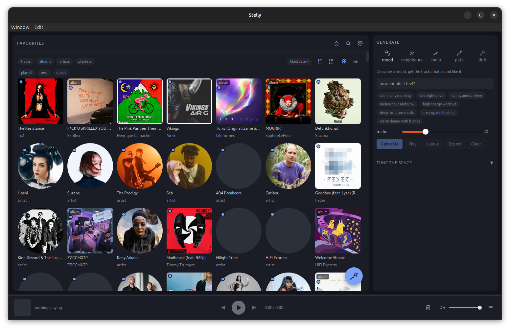
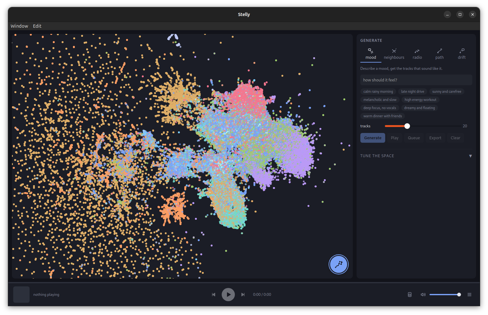
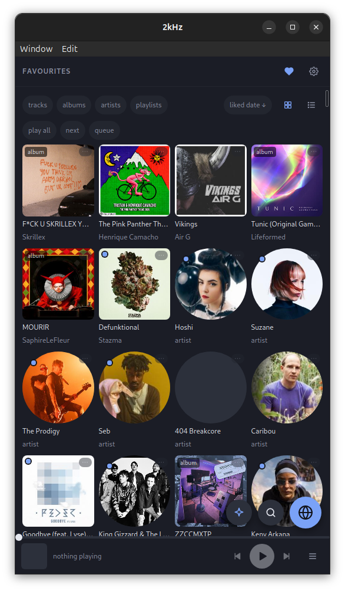

# Stelly

Music as a navigable space. Every track becomes a point in ~80 dimensions where
distance approximates perceptual similarity, so recommendation becomes geometry:
the nearest neighbours of a track, a path that morphs from A to B, or a drift in
a direction you describe in words.

A music catalogue's metadata stops at titles, credits and genres (no BPM, no
key, no energy), so the acoustic half of every vector is computed from the
audio itself.



Your likes in the main area, the generate panel always on the right, and
the player along the bottom. The two round buttons open search and the map.



The map: a UMAP projection of every analysed track, coloured by genre, over
the main area while the generate panel stays beside it.



On a narrow screen the generate panel slides in from the right over the main
area, from its own floating button.

## Shape of the system

Two programs, one of each side of a socket, and the music behind a third: a
**provider**, a small service in front of a catalogue that answers the
[provider protocol](https://github.com/nab-os/stelly-provider): search, a
track, an album, an artist and their discography, and where a track's audio
is. Stelly asks those and never learns what is behind them. A provider holds
whatever account its catalogue needs, and rations requests to it for
everything on the machine.

```
  stelly-server                                stelly (desktop, Android)
  ─────────────                                ─────────────────────────────
  the music through a provider                 neighbours · radio · path · drift
  crawl       likes → similar artists            → asked of the server
  analyse     middle 90s of each track         map, library, playback
                → CLAP (ONNX) + descriptors    caches the index, the map and
  build-space features → space.bin/json          the likes, opens on them
  layout      UMAP → map coordinates                     │
  space       loaded once, navigated per request         │
  embed       CLAP text tower                  plays the signed stream URL
         │                                               ▲
         └── /api/… + SSE for stage output ──────────────┘
                     audio never proxies
```

The server is one Rust binary: the API, the crawl and the whole analysis
pipeline, with CLAP running in ONNX Runtime. The apps are clients of it and
nothing else, there is no local mode, so a desktop on its own runs the server
beside it and pairs with it like any other device.

The part of the analysis that needs neither the network nor the database,
decoding, the descriptors and CLAP's audio tower, is a crate of its own,
[`stelly-audio`](https://github.com/nab-os/stelly-audio), open source and
shared with stelly-mix.

The space is queried, not synced: the server loads it once and answers every
walk, so a phone downloads nothing before it can generate, and opens straight
onto the app. A walk is a few milliseconds on the server, one round trip for
the client, with the weight sliders sent along with it. What a client keeps is
small and only a head start: the space's index, the map's points and the
likes, shown from the disk while the server is asked again.

Design notes, measurements and the space layout are in
[docs/design.md](docs/design.md).

## Setup

A Rust toolchain. The server needs nothing else; it fetches the CLAP weights
(~620MB, into `data/models/`) the first time a stage needs them, or up front:

```sh
cd server
cargo run --release -- models
```

The desktop app draws into a system webview, so on Linux it also wants GTK and
webkit headers at build time, without them the build stops at `glib-sys` with
`glib-2.0 was not found in the pkg-config search path`. `libwebkit2gtk-4.1` is
what wry links against; `libxdo` and the appindicator arrive via tao and
tray-icon:

```sh
sudo apt install build-essential pkg-config libwebkit2gtk-4.1-dev \
  libgtk-3-dev libsoup-3.0-dev libxdo-dev libayatana-appindicator3-dev \
  librsvg2-dev libssl-dev
```

The server needs none of it: it depends on `stelly-core`, the half the two
share, not on the app, which keeps dioxus, wry and GTK out.

### Providers

The server asks a catalogue for nothing itself: its providers do, for every
program on the machine. `STELLY_PROVIDERS` lists them, most preferred
first, a token where one is wanted as the URL's user:

```sh
STELLY_PROVIDERS=http://127.0.0.1:7711,http://secret@127.0.0.1:7710
```

or `STELLY_PROVIDER_URL` (default `http://127.0.0.1:7710`) and
`STELLY_PROVIDER_TOKEN` for just one, from the environment or `.env`.
`stelly-server whoami` says what it found. `compose.yaml` runs one beside
the server.

Three exist: [stelly-qobuz](https://hub.docker.com/r/stellymusic/stelly-qobuz),
in front of a Qobuz account, stelly-ytmusic, in front of a YouTube Music
one, and [stelly-local](https://github.com/nab-os/stelly-local), in front of
a folder of music files:

```sh
stelly-local serve ~/Music          # http://127.0.0.1:7710
```

Stelly speaks in ids of its own, and keeps which providers' items each
stands for. One recording on two providers is one track, analysed once and
one point on the map, when their ISRCs agree; albums are matched by artist
and title, artists by name. What else is one recording, the dedupe stage
hears.
It plays and analyses from the first provider in the list that has it, the
next if that fails. Search, artist pages and playlists gather from all of
them; a search can be narrowed to one, from the chips beside the search box
or with `/api/search?providers=local`.

A provider says what it can do: similar artists, which the crawl expands
through, the account's own likes and playlists, writing a playlist back,
following new releases. What none can, Stelly does without, and the app
does not offer.

An account's own likes on a provider become someone's in Stelly with:

```sh
stelly-server import --provider qobuz --user sasha            # tracks, albums, artists
stelly-server import --provider ytmusic --user lou --kinds tracks --dry-run
```

A database from before providers kept items in Qobuz's own shapes, keyed by
Qobuz's ids: the server has the provider that can convert them, the Qobuz
gateway, do so at start, once (`stelly-server convert-legacy` by hand), and
credits those ids to it. Keep it among the providers: without it, that
catalogue is nobody's, and only plays again once it is back.

## Running the pipeline

Every stage is a subcommand of the server, and also a button in the app's
**Pipeline** view, which runs the same code in the server's process.

```sh
cd server
cargo run --release -- whoami                   # each provider, and who it is signed in as
cargo run --release -- crawl --max-tracks 2000  # likes, then similar artists
cargo run --release -- analyse                  # fetch excerpts, extract features
cargo run --release -- dedupe                   # merge tracks that sound the same
cargo run --release -- build-space              # assemble vectors
cargo run --release -- layout                   # UMAP projection for the map
cargo run --release -- evaluate                 # space sanity check
cargo run --release -- status                   # what is done, what is due
```

Every stage is resumable: the crawl frontier lives in SQLite and analysis skips
what it has already done, so Ctrl-C and rerun is always safe.

To skip the queue for one thing, `analyse --track ID`, `--album ID` or
`--artist ID` catalogues it first if need be and analyses only that. In the
app, **Add to space** on a track, album or artist page does the same, then
rebuilds the space and the map. A backlog `analyse` already running pauses
for it and picks up where it was afterwards.

`analyse` stores the CLAP embedding and the descriptors and nothing derived, so
the mood and style scores, the weights and the PCA are all rebuilt by
`build-space` in seconds, change a label in `server/src/pipeline/labels.rs`
and rebuild, no re-analysis.

### Crawling

Seeds from everyone's likes, then expands outward through the provider's
similar artists. The likes keep the items they were made from, so seeding costs no requests; the app's crawl button seeds too, so a
like made since the last crawl is in it.

```sh
stelly-server crawl --max-tracks 5000   # likes, then similar
stelly-server crawl --no-seed           # resume the frontier only
stelly-server crawl --artist 43840      # one discography, queued
stelly-server crawl --album 0634904077969
```

Requests are limited to 2/s with retry-and-backoff on 429s, at the gateway:
one account pays for every call, and the crawl, `analyse`, every client's
browsing and whatever else uses the gateway share that one budget. The crawl
and `analyse` queue as bulk, so browsing goes ahead of them rather than
waiting its turn behind a backlog.

### Mixing

Beside the space's 90s excerpts, the server holds what
[stelly-mix](https://github.com/nab-os/stelly-mix) makes of whole tracks:
their beats, bars, eight-bar phrases and each phrase's CLAP embedding, which
is what mixing from one track into another is chosen and rendered from. A
whole track is ten times an excerpt's download and CPU, so it is analysed on
what is asked, never the whole catalogue:

```sh
stelly-server mix-analyse --album <id>                   # catalogued first if need be
stelly-server mix-analyse --artist <id>                  # or --track <id>
stelly-server mix-analyse --playlist <id>                # a provider playlist's tracks
stelly-server mix-analyse --favourites                   # the family's liked tracks and albums
stelly-server mix-analyse --mood "dark rolling techno" --count 200
stelly-server mix-analyse --around <track id> --count 50 # a track and its nearest in the space
stelly-server mix-analyse --artist-name "Lun"            # an artist's tracks in the space, and theirs
stelly-server mix-analyse --genre techno,house --limit 5000
```

An admin device can start the same with `POST /api/mix/analyse`
(`{"pick": "artist-name", "name": "Lun", "count": 20}`, `stelly_mix::api::Selection`;
`stelly-mix server-analyse "artist-name/Lun"` sends it), follow it with
`GET /api/mix/analyse` and stop it with `POST /api/mix/analyse/stop`. The
whole track comes as MP3 320 through the gateway and is dropped once
analysed; the analysis goes in the `mix` table.

Clients read it with `play` devices: `/api/mix/library`, `/api/mix/tracks`
(several at once, for a client mirroring the library), `/api/mix/next/<id>`,
`POST /api/mix/set` and `/api/mix/find?q=`, in `stelly_mix::api`'s shapes.
`stelly-mix sync` mirrors the library into stelly-mix's own, and its app does
at start, given `STELLY_SERVER` and `STELLY_TOKEN`.

The server builds stelly-mix's renderer, Signalsmith Stretch, from C++: the
build wants `clang` and `libclang-dev` besides the rest.


### Deduplicating

Catalogues file one recording under several entries, a single and its
album, compilations, reissues, clean and explicit editions, and providers
give it different ids and sometimes no ISRC. `dedupe` merges the tracks
that are one by their CLAP embeddings: cosine similarity 0.995 or more and
lengths within two seconds, or 0.999 between tracks whose ISRCs differ,
which only the same master reaches. A track merges with the one it is kept
as, never through a chain of others, so an audiobook's chapters in one voice
stay chapters. The one kept is the closest to a like; the others' providers'
items and likes become its, and `track_merges` remembers each merge, so an
id a device still holds keeps playing. Each run compares only what was
analysed since the last; on the production catalogue, the first merged
52,887 tracks of 192,410 in under a minute. `--dry-run` says what it would
merge.

## Running the app

Start the server, pair a device, and point the app at it:

```sh
cd server
cargo run --release -- pair --name desktop --scope admin   # prints a token, once
cargo run --release -- serve                                  # 127.0.0.1:7700

cd app
STELLY_SERVER=http://127.0.0.1:7700 STELLY_TOKEN=<token> cargo run --release
```

Without those two variables the app opens on a setup screen that asks for the
address and token once and remembers them.

Two views, switched from the header, over a transport bar that stays put.

**Explore** is three columns: the catalogue live on the left, the map in the middle, the
analysed space on the right. Clicking a track plays it and makes the list you
clicked in the queue. **in space** selects an analysed track on the map;
**fetch** pulls an album's tracklist, or an artist's discography, into the
catalogue.

Generation is one panel with four modes:

| mode | what it does |
|---|---|
| neighbours | the *k* most similar tracks; follows the selection as you browse |
| radio | a greedy walk, each jump to the nearest track not yet played |
| path | A to B, either the shortest route or an evenly paced interpolation |
| drift | away from the selection, towards a phrase |

Radio has an *artist pull* slider, which stops a walk sitting inside one
discography. Map positions are fixed until `layout` is re-run, the weight
sliders change which tracks are near each other, not where the dots sit.

**Pipeline** runs the four stages on the server and streams their output into a
log. A stage started from a client **outlives that client**, start `analyse`
from a phone and walk away, so **stop** is the only thing that ends one early.

**Playback** offers lossy, CD quality or hi-res, as far as the provider
has them, streamed from wherever it says straight to the device.

To try the app without a provider, build a synthetic corpus, eight fake albums run
through the real pipeline, and serve that:

```sh
cd server
cargo run --release -- demo /tmp/stelly-demo
STELLY_DATA_DIR=/tmp/stelly-demo/data cargo run --release -- pair --name demo --scope admin
STELLY_DATA_DIR=/tmp/stelly-demo/data cargo run --release -- serve
```

## Hiding an artist

`blocked_artists` is a table everything honours: the pipeline will not crawl
them, follow them to their similar artists, analyse their tracks or place them
in the space, and the app hides what is already stored and refuses to play it.

```sh
stelly-server block "artist name"       # or an artist id
stelly-server block 224109 --reason "why"
stelly-server blocked                   # list
stelly-server unblock 224109
```

Or click **hide** on any artist or track in the app, from an `admin` device:
the space is the whole family's, so a `play` device sees the list but cannot
change it. The **Hidden artists** row in settings lists them with a way back.

Hiding filters rather than deletes, which is what lets a block take effect
immediately and be undone. `block --purge` deletes the tracks, features and
albums instead; re-run `build-space` and `layout` afterwards.

The match is on `artists.id`, so a featured credit that the provider files under a
different artist id can still surface, block those ids too. An ambiguous name
refuses to act rather than guessing.

## Devices and the network

Two scopes, both authenticated: `play` is browsing, navigating and minting a stream
URL, and **Add to space**, which is bounded; `admin` is crawling and
analysing the whole backlog, hiding artists, and pairing devices and adding people. A
`play` device can still pair more `play` devices for its own person, and revoke them. Each device gets its own token, stored
only as a SHA-256 hash, so one phone can be revoked without re-pairing the rest.

A person's devices share one queue. The speaker button in the player bar lists
the ones connected, under the name they were paired with, and picks which one
plays; the others become remotes for it.

```sh
stelly-server pair --name phone --scope play
stelly-server devices
stelly-server revoke 3
```

### A family

One server is sized for a family: a few people who trust each other, sharing
the one music account. It is not meant to be a public server, and nothing in
it tries to be.

Each person has their own devices, their own queue and their own likes. The
speaker in the living room only answers to the queue it was picked from, and
nobody sees anyone else's likes. What is shared is the music account and its
2 requests a second, though browsing goes ahead of a crawl in its queue,
its playlists, and the space, which the crawl grows from the whole
family's likes. Playlists exported from the app are named after whoever
exported them.

Likes are kept by Stelly and never written to the provider, and start empty: the
account's own favourites are not brought in.

```sh
stelly-server user add sam
stelly-server pair --name phone --user sam
stelly-server user list
stelly-server user rename sam samuel
stelly-server user remove samuel              # once their devices are revoked
```

An `admin` device can do the same from the app's settings: add someone
under **People**, then pair them a device. A `play` device sees and can revoke
only its own person's devices. A server from before users puts the devices it
already has under `owner`; rename that to whoever it is.

This speaks plain HTTP and binds to loopback. Anything beyond loopback belongs
behind WireGuard/Tailscale or a TLS proxy.

## Docker

The server ships as one image, so the machine that hosts it needs no Rust
toolchain.

```sh
docker run -d --init --name stelly -p 127.0.0.1:7700:7700 \
  -v stelly-data:/data --env-file .env stellymusic/stelly:<version>

docker exec stelly stelly-server pair --name phone --scope play
```

[`compose.yaml`](compose.yaml) is the worked version, pairing, the volumes and
the loopback-only port mapping.

The image carries the API and the whole pipeline; the CLAP weights are fetched
into the `/data` volume on first use (`docker exec stelly stelly-server
models` to do it up front). It is published to Docker Hub and GHCR with a
version tag and `:latest`, but everything here pins a version, so that pulling
never silently changes the server underneath a corpus that took hours to build.
`docker build .` reproduces it when you need to run uncommitted changes.

The container binds `0.0.0.0` and publishes to `127.0.0.1`, which keeps the
loopback property above: the bind has to be `0.0.0.0` to be reachable across
the container boundary at all, so it is the *published* port that is
restricted.

Catalogue credentials are not this image's at all: the provider holds them,
in an image of its own, and [`compose.yaml`](compose.yaml) runs the two side by
side. The corpus, the space, the device tokens and the model weights all live
in the `/data` volume, which is the only thing here worth a backup, with the
provider's own.

## Android

A client like the desktop app, built for a phone.

```sh
cd app
. ./android-env.sh                 # ANDROID_HOME / NDK / per-API clang wrappers
dx build --release --platform android --target aarch64-linux-android \
   --no-default-features --features mobile

adb install -r ../target/dx/stelly/release/android/app/app/build/outputs/apk/debug/app-debug.apk
```

`--target` matters: without it `dx` builds x86_64 for an emulator, which will
not install on a phone. **arm64 only**, `manganis`, the asset crate dioxus
pulls in, refuses to build for 32-bit Android.

Pairing happens on a setup screen rather than through environment variables, and
is stored in `server.json` in the app's own data directory.

Use `dx`, not `cargo android build`, the two generate conflicting JNI
trampolines. `gen/`, `mobile.toml` and the `[package.metadata.cargo-android]`
block are leftovers from `cargo mobile init` and are unused.

## Packages

`.github/workflows/build.yml` builds on every push to `main`, on `v*` tags, and
on demand. A tag additionally opens a GitHub release with everything attached.

| target | artifacts |
|---|---|
| Ubuntu 24.04 | `.deb`, `.AppImage`, `.tar.gz`, desktop and server separately |
| Ubuntu 26.04 | the same, built on 26.04 |
| Windows | x64 `-setup.exe` (per-user, no admin) and `.msi`, desktop only |
| Android | one signed arm64 `.apk` |
| Docker | `stellymusic/stelly` and `ghcr.io/…/stelly-server` |

Each Ubuntu release builds on its own runner, and the desktop and server
packages are separate, see [docs/design.md](docs/design.md#packaging).

The image is built on every push so a broken `Dockerfile` fails next to the
`.deb`s, but only pushed from a tag. It needs `DOCKERHUB_USERNAME` and
`DOCKERHUB_TOKEN` as repository secrets; the GHCR half uses `GITHUB_TOKEN` and
needs nothing.

To try a branch on a real host before a release, `docker-dev.yml` publishes
just the server image as `:dev` or `:nightly`: push to a branch or move a tag
with that name (`git push -f origin HEAD:dev`), or run it by hand on any branch
with `gh workflow run docker-dev.yml --ref <branch> -f tag=nightly`. It never
moves `:latest` or a version tag.

The Android job signs when it can read the keystore secrets and falls back to
an unsigned `…_arm64-unsigned.apk` when it cannot, rather than being skipped.
That fallback is there for pull requests from forks, which structurally cannot
read a secret: arm64 still gets compiled, it just produces a file `adb install`
will refuse. A **tag fails instead** of falling back, so a release can never
carry an APK nobody can install.
